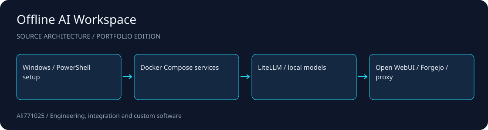

# Offline AI Workspace

**A Windows-oriented deployment toolkit for a local AI gateway, chat UI and supporting services.**

Docker Compose · PowerShell · Local AI infrastructure

[راهنمای فارسی](docs/README.fa.md) · [Architecture](docs/ARCHITECTURE.md) · [Discuss a project](https://github.com/Ali771025)

## What this demonstrates

- Compose definitions for LiteLLM, Open WebUI, Forgejo and a reverse proxy.
- PowerShell prerequisite, offline image import, start/stop and backup tooling.
- Separate model gateway, UI and service configuration for customer-specific integration.

## Source map

| Path | Responsibility |
| --- | --- |
| `docker-compose.yml` | Primary service definition |
| `docker-compose.full.yml` | Extended service definition |
| `scripts/` | Setup and lifecycle scripts |
| `config/` | Gateway and proxy configuration |

## Setup and integration

Requires Windows with PowerShell, WSL2 / Docker, compatible local model services, and the services referenced by your selected compose file. Review all scripts before execution: several change firewall rules, WSL settings or restore service data. Create a private `.env` containing fresh credentials and host settings required by the compose interpolation; see docs/CONFIGURATION.md. Offline operation requires locally prepared container images, installers and model weights, none of which are distributed here. Image tags are source configuration, not a promise of current upstream availability.

## Scope and evidence

Infrastructure source edition only. No customer hosts, credentials, data backups, containers or model weights are included. No current deployment or offline completeness result is claimed. Third-party services and images remain governed by their original licenses; secure network exposure and service hardening are deployment responsibilities.

This public portfolio edition contains selected source and integration manifests. Contracts, private data, customer materials, original Git history, dependency trees and large assets are excluded. No tests, builds or application runs were performed for this publication; no previous result is presented as a current validation.

## Work with me

I am available for projects involving Docker Compose, PowerShell, Local AI infrastructure. For a useful first discussion, share the problem, target environment, expected deliverables and acceptance criteria. I can help scope an implementation, integration or improvement around your constraints.

Contact: [Ali771025 on GitHub](https://github.com/Ali771025). Please share confidential material through an agreed private channel.

## Rights and dependencies

Publication for portfolio review does not grant a new blanket license. Existing file notices and dependency terms continue to apply. Contact the author to agree terms for reuse or a commercial engagement.
