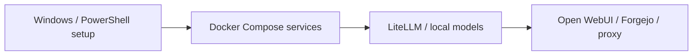

# Offline AI Workspace architecture

The diagram describes the source responsibilities, not a measured production deployment.

| Module | Responsibility |
| --- | --- |
| `docker-compose.yml` | Primary service definition |
| `docker-compose.full.yml` | Extended service definition |
| `scripts/` | Setup and lifecycle scripts |
| `config/` | Gateway and proxy configuration |

Infrastructure source edition only. No customer hosts, credentials, data backups, containers or model weights are included. No current deployment or offline completeness result is claimed. Third-party services and images remain governed by their original licenses; secure network exposure and service hardening are deployment responsibilities.
